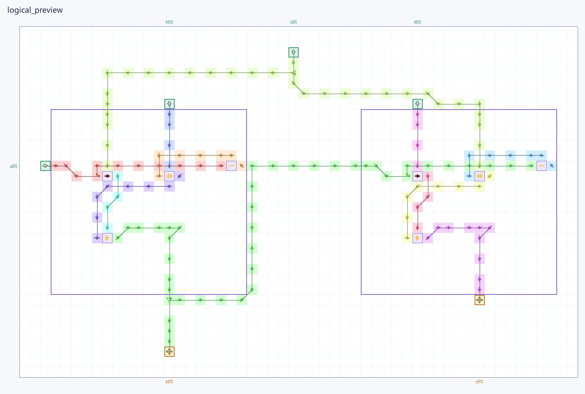

# ArrowsHDL

ArrowsHDL — компилятор Verilog/SystemVerilog в физические схемы Logic Arrows.
Пакет предоставляет CLI и Python API для компиляции, компоновки, симуляции,
проверки и экспорта игровых сохранений.

Версия: **0.1.0**, экспериментальная.

## Требования

- Python 3.11 или новее.
- pip для установки пакета и его зависимостей.
- Готовый wheel для вашей операционной системы и архитектуры.

Yosys (`yowasp-yosys`), Node.js (`nodejs-wheel-binaries`) и Pillow
устанавливаются автоматически через pip. Готовый wheel содержит
скомпилированный симулятор; **Rust/Cargo для его установки и запуска не требуется**.

## Установка

1. Откройте [страницу релизов ArrowsHDL](https://github.com/NnicanBuak/ArrowsHDL/releases).
2. В разделе **Assets** выбранного релиза скачайте файл `.whl` для вашей
   операционной системы и архитектуры. Например, тег `win_amd64` обозначает
   Windows x64. Архивы **Source code** для этой установки не нужны.
3. Установите скачанный файл через pip и проверьте работоспособность:

В команде ниже замените `ПОЛНЫЙ_ПУТЬ_К_СКАЧАННОМУ_WHEEL.whl` фактическим
путём к файлу, который вы скачали из релиза. Команды можно выполнить из любого каталога.

~~~powershell
python -m pip install "ПОЛНЫЙ_ПУТЬ_К_СКАЧАННОМУ_WHEEL.whl"
arrowshdl health
~~~

**На 13 октября 2026 года опубликованных релизов нет.** Скачать готовый
wheel по этой инструкции можно будет после публикации релиза с подходящим
файлом `.whl` в Assets. Успешная проверка `arrowshdl health` завершается с кодом **0**.

## Быстрый старт

Команды выполняются из корня репозитория после установки пакета.
`python -m arrowshdl` эквивалентен `arrowshdl`.

~~~powershell
arrowshdl build examples/alu_workbench/project.toml -o build/alu.save.txt
arrowshdl preview examples/alu_workbench/project.toml -o build/alu/map.png
arrowshdl preview examples/alu_workbench/project.toml --style logical -o build/alu/logical.png
~~~

Сборка создаёт только закодированную игровую схему `.save.txt`. Клетки и метаданные
компиляции остаются в памяти и доступны через Python API; JSON-карта и sidecar-файлы
компиляции не создаются. Тестовые источники и пробники строятся в памяти на копии
итоговой схемы непосредственно во время теста.

## Использование CLI

Общая справка: `arrowshdl --help`; справка команды: `arrowshdl compile --help`.
**`-o` / `--out`** задаёт имя файла результата: игровой схемы, объекта,
отчёта, преобразованного файла или PNG.

### Проверка работоспособности

~~~powershell
arrowshdl health
~~~

Команда проверяет запуск Node.js, наличие исполняемого файла симулятора,
компиляцию встроенной схемы, экспорт и чтение сохранения, результаты
физической симуляции и создание PNG. Проверки выполняются во временном
каталоге. Вывод на английском содержит статус каждого компонента;
код завершения **0** означает успех, **1** — сбой проверки.

### Компиляция HDL и проект TOML

`-o FILE` задаёт путь к **одному выходному файлу** с расширением `.txt`.
Компилятор сразу записывает игровую схему; порты и характеристики сборки
возвращаются Python API в объекте `BuildResult`. Каталог в `-o` не допускается.
Предпросмотр и отчёт создаются отдельными командами.

Процессы выводят этапы и процент выполнения в stderr. Процент относится
к этапам операции; трассировщик дополнительно сообщает число обработанных
цепей, оставшиеся цепи и перестроения. Повторные попытки размещения могут
увеличивать длительность этапа. 100% выводится после успешного завершения. Все встроенные сообщения CLI,
справка и диагностика ошибок выводятся на английском языке.

~~~powershell
arrowshdl compile examples/alu_workbench/arithmetic.v --top arithmetic --std 1364-2005 -G WIDTH=4 -o build/compiled.save.txt
arrowshdl build examples/packet_router/project.toml -o build/router.save.txt
arrowshdl build examples/minesweeper/project.toml -o build/mines.save.txt
~~~

TOML v3 задаёт верхний HDL-модуль, исходники и параметры. Иерархия экземпляров
и связи портов берутся из HDL; необязательный `design.toml` отдельно задаёт
кнопки, дисплеи и размещение компонентов. Каждая уникальная специализация
HDL-модуля компилируется один раз, а готовые карты экземпляров соединяются по
иерархии исходного проекта.
Параметры `compile`: `-I каталог` для include, `-D NAME=VALUE` для макроса,
`-G NAME=VALUE` для параметра верхнего модуля, `-L файл.v` для библиотеки.
Стандартная нативная библиотека подключается автоматически.
`--timeout` ограничивает время **всей операции** в секундах (по умолчанию 600),
`--max-cells` — число клеток (по умолчанию 1 000 000).

По умолчанию используется **`--layout auto`**: размещение по связям графа,
сокращение эквивалентной комбинационной логики и разводка. Шины сохраняют
порядок битов; входы размещаются ближе к потребителям, выходы — к источникам.
Размер скомпилированного модуля оценивается целиком, включая его порты. Геометрические шаблоны
арифметических блоков в этом режиме не используются.

**`--compact`** включает дополнительные формы размещения и эвристический
поиск. Он требует больше времени; скомпилированный модуль содержит не больше
стрелок и занимает не большую площадь, чем обычная компиляция того же модуля.
Поиск не гарантирует глобальный минимум.

~~~powershell
arrowshdl build examples/packet_router/project.toml --compact -o build/router-small.save.txt
arrowshdl compile examples/alu_workbench/arithmetic.v --top arithmetic --compact -o build/math-small.save.txt
~~~

| Режим | Назначение |
| --- | --- |
| `--layout auto` | Автоматическое размещение по графу, включая нативную память и панели управления. Используется по умолчанию. |
| `--compact` | Дополнительный поиск расположений в режиме `auto`; выбирается проверенный вариант с меньшим числом стрелок и площадью. |
| `--layout compact` | Прежний поисковый алгоритм для комбинационной логики. |
| `--layout sparse` | Разреженная разводка комбинационной логики; увеличивает расстояния и размер карты. |
| `--layout macro-grid` | Диагностическая сетка нативных элементов без поиска компактного размещения. |
| `--layout fixed` | Структурная схема с заранее подготовленной физической геометрией. |

`--layout compact` и `sparse` не поддерживают нативные элементы памяти.
Панели управления требуют `auto`. `--compact` применяется с `--layout auto`.

### Повторное использование скомпилированных схем

`build` хранит готовые модули в системном каталоге кеша ArrowsHDL.
На Windows это `%LOCALAPPDATA%/ArrowsHDL/cache`; переменная
`ARROWSHDL_CACHE_DIR` задаёт другой каталог. Ключ учитывает
исходники, include-файлы, параметры, стандарт, определения и настройки
компилятора. Одинаковые экземпляры используют одну скомпилированную карту;
повторный `build` читает её из кеша. Изменение входных данных создаёт новую
сборку. Внутренние клетки готовой схемы при сборке карты сохраняются.

Для явной двухэтапной сборки:

~~~powershell
arrowshdl compile examples/minesweeper/mine_cell.v examples/minesweeper/seven_segment.v --top mine_cell --std 1364-2005 --compact -o build/tile.save.txt
~~~

Команда создаёт один игровой файл `build/tile.save.txt`. Для повторного
использования такой схемы сохраните рядом TOML-дескриптор с портами и метаданными
компонента; Python API также возвращает их в `BuildResult.metadata`.
TOML проекта может подключить готовый результат без HDL-исходников:

~~~toml
[[components]]
name = "cell_0"
file = "build/tile.component.toml"
~~~

Путь file задаётся относительно TOML. Добавление нескольких components с
разными name и одним file размещает копии одной готовой схемы. `--compact`
применяется при компиляции модуля; готовые components повторно не синтезируются.
Время и размер межмодульной разводки зависят от связей проекта.

### Объектная компиляция и компоновка

~~~powershell
arrowshdl compile -c examples/alu_workbench/arithmetic.v --top arithmetic -o build/math.aho.json
arrowshdl link build/math.aho.json --top arithmetic -o build/linked.save.txt
~~~

`-c` сохраняет объект RTLIL без размещения. `link` принимает несколько
объектов, объединяет модули и строит карту. Для раздельной компиляции
`compile -c --extern имя` оставляет объявленный интерфейс до компоновки.

### Проверка логики и симуляция по тактам

~~~powershell
arrowshdl build examples/pulse_sequencer/project.toml -o build/sequencer.save.txt
~~~

Для обычных тестов используйте Python: `arrowshdl.test_harness.run_vectors`
генерирует тестовые источники, приёмники и сценарии в памяти и проверяет
физическую симуляцию итоговой карты. CLI `test`/`simulate` принимают явно
заданный физический сценарий JSON; он описывает `ticks`, входы, наблюдения и
ожидаемые значения, а не отдельную тестовую схему.

~~~powershell
python -m unittest tests.projects.examples.test_showcases.ShowcaseTests.test_alu_all_2048_words -v
~~~

Физический сценарий задаёт `ticks`, `inputs` для тестовых источников,
`controls` для кнопок, `probes` для свободных приёмников, `observe` для
считывания существующих клеток и `assert` / `expect` для проверок.
Значения — `0`, `1`, а `null` в проверке пропускает отсчёт.
`simulate` и `test` используют один физический симулятор. Отчёт содержит
трассы и SHA-256 входного сохранения. Код завершения: **0** — успех или
трасса без проверок, **1** — провал проверки, **2** — ошибка команды.
`--no-optimize-cycles` отключает оптимизацию циклов.

### Сохранения, граф и изображения

~~~powershell
arrowshdl decode build/alu.save.txt -o build/alu/decoded.json
arrowshdl encode build/alu/decoded.json -o build/alu/roundtrip.save.txt
arrowshdl graph build/alu.save.txt -o build/alu/graph.json
arrowshdl preview build/alu.save.txt -o build/alu/preview.png
arrowshdl health
~~~

`decode` экспортирует сохранение в JSON-модель для анализа, `encode` импортирует
такую модель обратно в игру,
`graph` экспортирует клетки и физические зависимости,
`preview` рисует реальные стрелки; `health` проверяет работоспособность установленного пакета.
Флаг `--style logical` накладывает цветные линии графа сигналов на реальную
схему, подкрашивает клетки стрелок по цвету сигнала, обводит логические модули
и выделяет I/O. Линии проходят внутри рамок модулей, но прерываются на клетках
логических операторов. Возле каждого входа и выхода показано имя порта с индексом.
Цвет линии меняется при прохождении через логический узел и сохраняется через
буферы. Кроме заголовка схемы, на изображении есть только подписи портов.
По умолчанию используется `--style default`.
Логический вид требует метаданные схемы. Для нового проекта передавайте его
TOML-файл или HDL-исходник: CLI скомпилирует схему и возьмёт метаданные прямо
из результата сборки. Для уже сохранённой `.txt`-карты можно передать manifest
через позиционный аргумент.

Небольшая схема из двух логических модулей нагляднее показывает этот режим:

Её можно собрать и визуализировать командами:

~~~powershell
arrowshdl build examples/logical_preview/project.toml -o build/logical_preview.save.txt
arrowshdl preview examples/logical_preview/project.toml --style logical -o build/logical_preview.png
~~~

## Примеры

| Проект | Описание |
|---|---|
| [Logical Preview](examples/logical_preview/README.md) | Небольшая схема для просмотра графа сигналов и границ модулей |
| [Minesweeper](examples/minesweeper/README.md) | Игра с безопасным первым кликом, каскадным открытием, счётчиками и статусом |
| [ALU Workbench](examples/alu_workbench/README.md) | Иерархическая ALU с восемью операциями и флагами результата |
| [Packet Router](examples/packet_router/README.md) | Маршрутизатор с проверкой чётности, арбитражем и backpressure |
| [Pulse Sequencer](examples/pulse_sequencer/README.md) | Семь генераторов, восемь режимов, память выбора и история сигнала на 64 такта |

Корень каждого примера содержит README, один TOML и Verilog-модули.
`build/` предназначен для итоговых игровых схем и выбранных пользователем отчётов;
тестовые fixtures генерируются в памяти. `visuals/` содержит изображения.
Исторические клеточные
реализации сохранены в `tests/fixtures/historical`.

## Разработка и тестирование

Для установки из исходников при разработке дополнительно требуется Rust/Cargo:

~~~powershell
python -m pip install -e ".[test]"
arrowshdl test --suite tests
~~~

Регрессионные тесты расположены в `tests`, тестовые данные — в
`tests/fixtures`. Набор включает проверки компилятора, симулятора,
публичного API и проектов из `examples`.

Генерация визуализаций примеров:

~~~powershell
python tools/render_examples.py
~~~

## Ограничения

Поддерживается синтезируемый поднабор Verilog/SystemVerilog.
Произвольная поведенческая последовательная логика не поддерживается;
память реализуется нативными модулями библиотеки. Автоматическое размещение
ограничено заданным бюджетом времени и числом клеток.

## Документация и лицензия

Подробные форматы и Python API: [справочник](docs/reference.md).
Устройство компилятора: [ARCHITECTURE.md](ARCHITECTURE.md).
Собственный код: [PolyForm Noncommercial 1.0.0](LICENSE), [NOTICE](NOTICE).
Сторонние материалы: [THIRD_PARTY_NOTICES.md](THIRD_PARTY_NOTICES.md).
