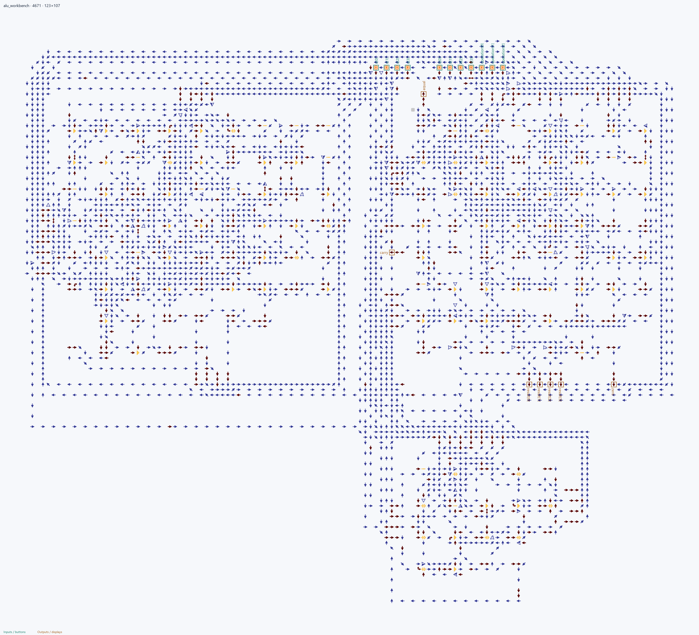

# ALU Workbench

**4-битная ALU из трёх HDL-модулей:** arithmetic реализует цепь переноса, logic_unit — булевы операции, alu_select — выбор результата и флаги. Пример показывает параметры, иерархию, арифметику, шины и автоматическую разводку.

| operation | Действие |
| ---: | --- |
| 0 | ADD: a + b |
| 1 | SUB: a − b |
| 2 | AND |
| 3 | OR |
| 4 | XOR |
| 5 | NOT a |
| 6 | Сдвиг a влево на 1 |
| 7 | Передать b |

Входы a[3:0], b[3:0], operation[2:0]; результат обрезается до 4 бит. carry означает перенос ADD, отсутствие займа SUB или вытесненный старший бит SHL. zero означает result=0, equal — a=b.

## Сборка и проверка

Из корня репозитория:

~~~powershell
arrowshdl build examples/alu_workbench/project.toml -o examples/alu_workbench/build/alu_workbench.save.txt --preview examples/alu_workbench/visuals/map.png
python -m unittest tests.projects.examples.test_showcases.ShowcaseTests.test_alu_all_2048_words -v
~~~

Регрессия компилирует исходный проект и проверяет **2048 наборов** независимой целочисленной моделью. Сохранение и PNG при сборке получаются из одной физической карты.

[Физическая карта стрелок](visuals/map.png). Иллюстрации пересобираются командой python tools/render_examples.py.
