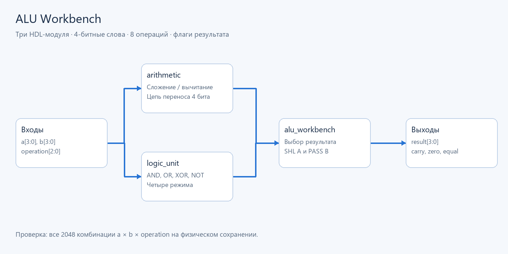
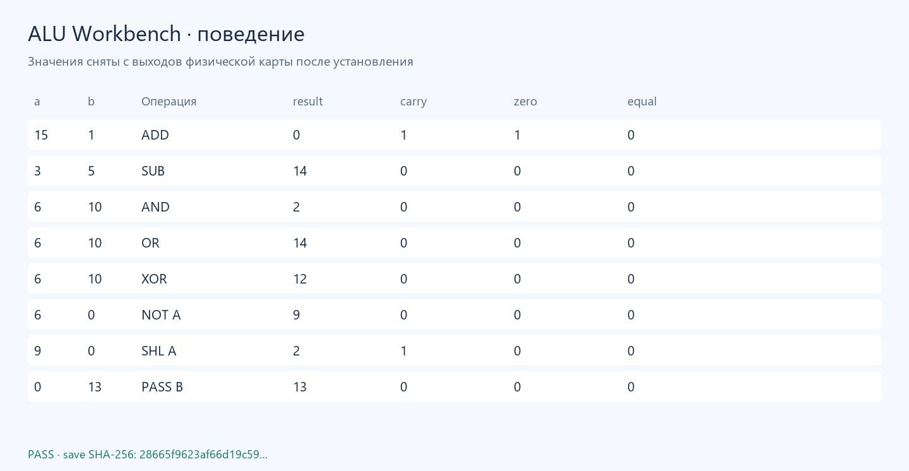

# ALU Workbench

**4-битная ALU из трёх HDL-модулей:** `arithmetic` реализует цепь переноса,
`logic_unit` — булевы операции, `alu_workbench` — выбор результата и флаги.
Это пример параметров, иерархии, арифметики, шин и автоматической разводки.

| operation | Действие |
|---:|---|
| 0 | ADD: a + b |
| 1 | SUB: a − b |
| 2 | AND |
| 3 | OR |
| 4 | XOR |
| 5 | NOT a |
| 6 | Сдвиг a влево на 1 |
| 7 | Передать b |

Входы `a[3:0]`, `b[3:0]`, `operation[2:0]`; результат обрезается до 4 бит.
`carry` означает перенос ADD, **отсутствие займа** SUB или вытесненный старший
бит SHL; для остальных операций он равен 0. `zero` означает result=0,
`equal` — a=b. Это комбинационная схема; между изменением кнопок и чтением
индикаторов нужно дождаться `settle_ticks` из manifest.

## Сборка и проверка

Из корня ArrowsHDL:

~~~powershell
arrowshdl build examples/alu_workbench/project.toml --layout macro-grid -o examples/alu_workbench/build
arrowshdl test examples/alu_workbench/build/alu_workbench.save.txt examples/alu_workbench/vectors.json --vectors --manifest examples/alu_workbench/build/alu_workbench.build.json -o build/alu-demo.report.json
python -m unittest tests.projects.examples.test_showcases.ShowcaseTests.test_alu_all_2048_words -v
~~~

[Сохранение](build/alu_workbench.save.txt): **16 942 стрелки, 235×713**.
Автоматические кнопки соответствуют битам входных портов; индикаторы —
битам выходов. Точные координаты и порядок битов: [manifest](build/alu_workbench.build.json).
[Полный отчёт](build/alu_workbench.report.json) проверяет **2048** наборов независимой
целочисленной моделью. `vectors.json` содержит короткую демонстрацию всех операций.

[Физическая карта стрелок](visuals/map.png) ·
[Данные визуализации с хешем сохранения](visuals/behavior.report.json).
Визуализации воспроизводятся командой `python tools/render_examples.py`.
