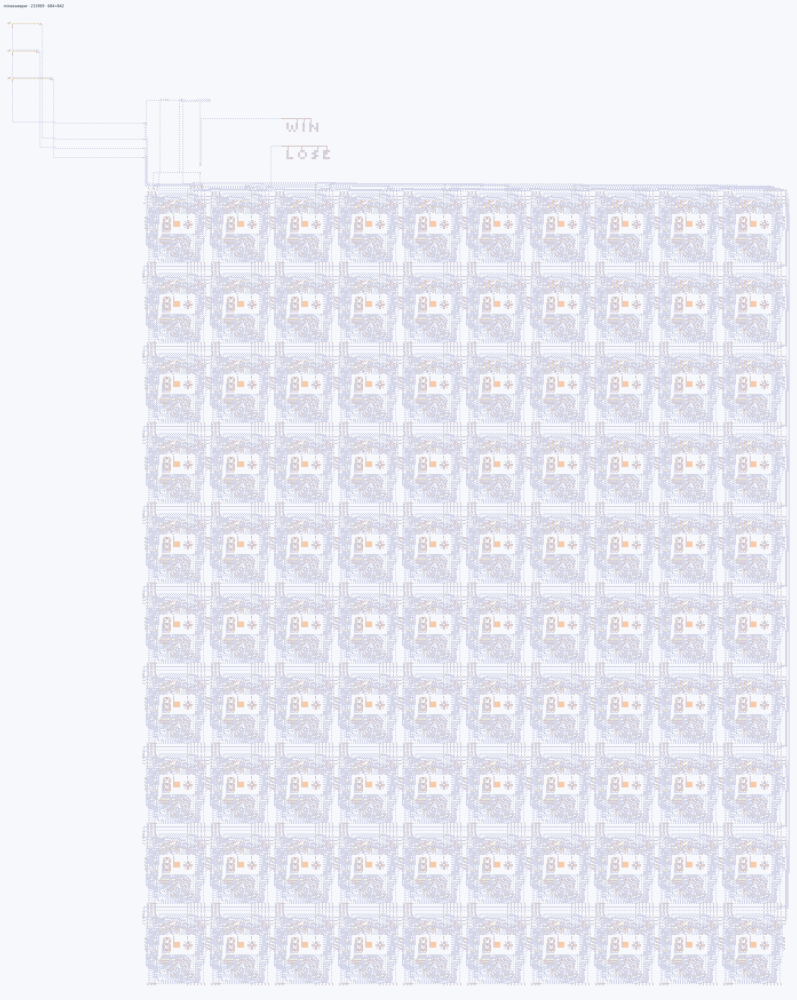
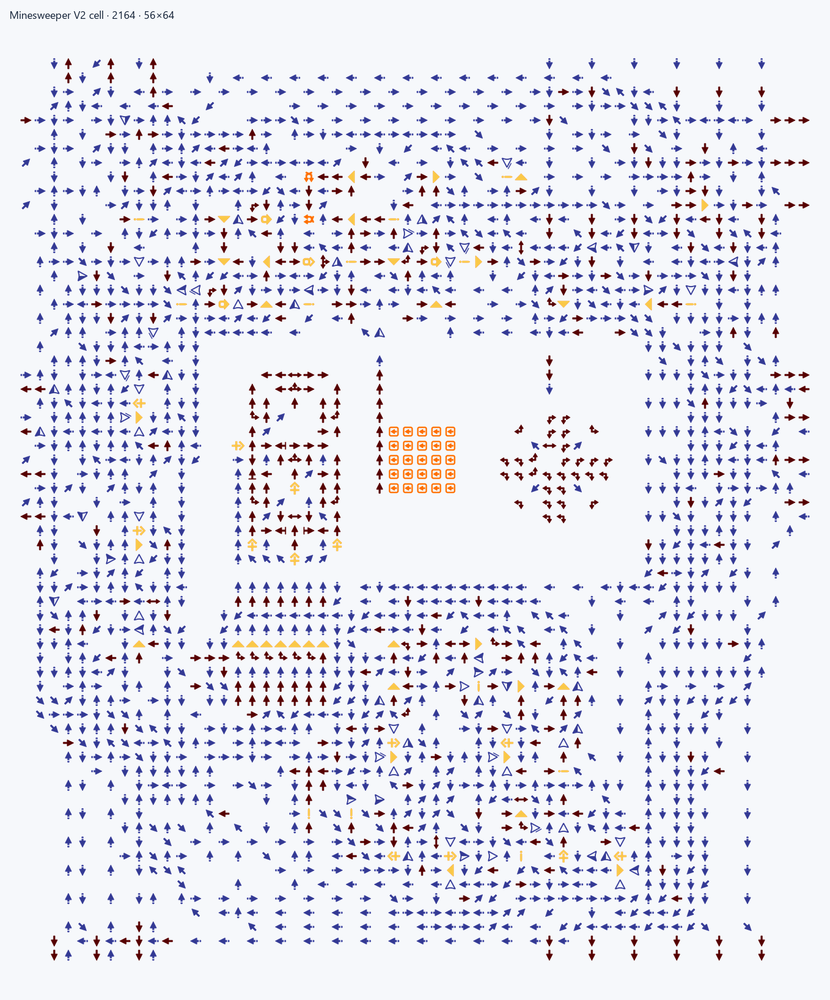
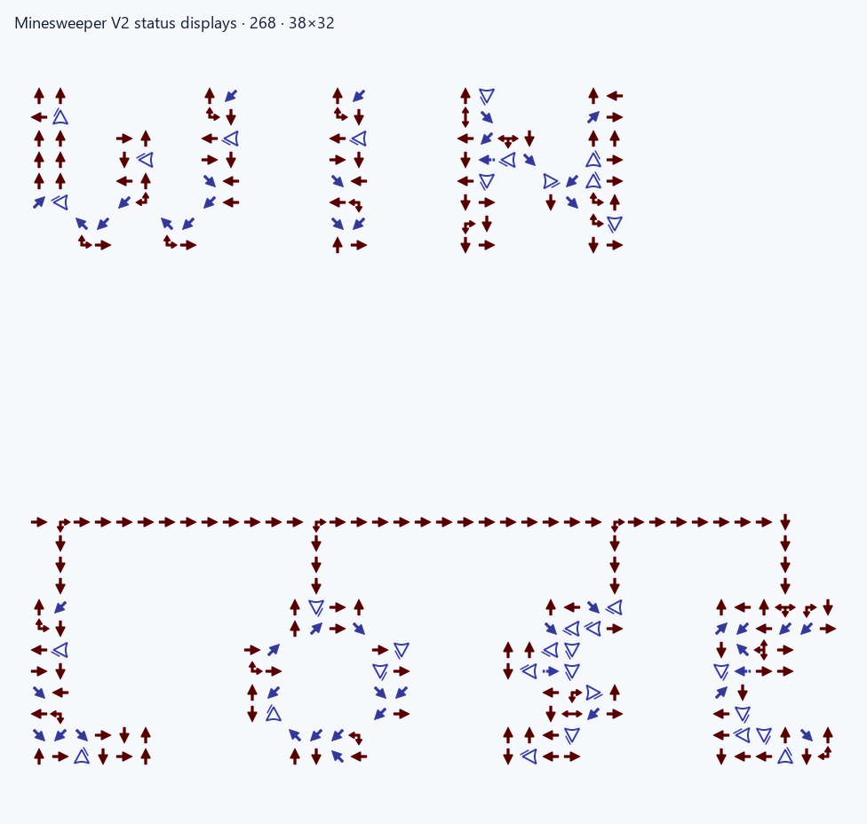

# Minesweeper V2

**Поле 10×10 содержит 233 969 стрелок и занимает координаты [0,0]–[683,841].** Карта точно совпадает с пользовательским эталоном по координатам, типам и ориентации каждой стрелки. Сборка начинает с HDL и project.toml; design.toml размещает 100 ячеек по заданной сетке.

## Исходники и размещение

- mine_cell.v задаёт повторяемую игровую ячейку и её электрические связи.
- minesweeper.v соединяет 100 ячеек, состояние игры, ввод и дисплеи.
- project.toml выбирает модуль minesweeper, HDL-файлы и язык.
- design.toml указывает origin, step и предельный размер каждого элемента сетки.

Сетка использует путь rows[*].cols[*].tile, начало [120,148], шаг [56,70] и предел [56,64]. Компилятор проверяет реальные границы ячеек и физические контакты HDL. Готовая карта не используется как вход сборки.

Подробности форматов: [минимальный HDL-проект и CLI](../../docs/reference.md#минимальный-проект-от-hdl-до-проверки), [правила сетки](../../docs/reference.md#toml-v3-hdl-проект-и-описание-схемы).

## Сборка и проверка

Из корня репозитория после установки ArrowsHDL:

~~~powershell
arrowshdl build examples/minesweeper/project.toml --layout compact -o examples/minesweeper/build/minesweeper.save.txt --preview examples/minesweeper/visuals/map.png
python -m unittest tests.projects.examples.test_minesweeper.MinesweeperTests.test_safe_first_flood_count_win_lose_and_reset -v
~~~

Сборка создаёт одно игровое сохранение .save.txt и, по запросу, PNG той же карты. Регрессия повторно компилирует HDL, сверяет карту с эталонным хешем, проверяет состояние поля на двух seed и кнопку с заданным поворотом.

