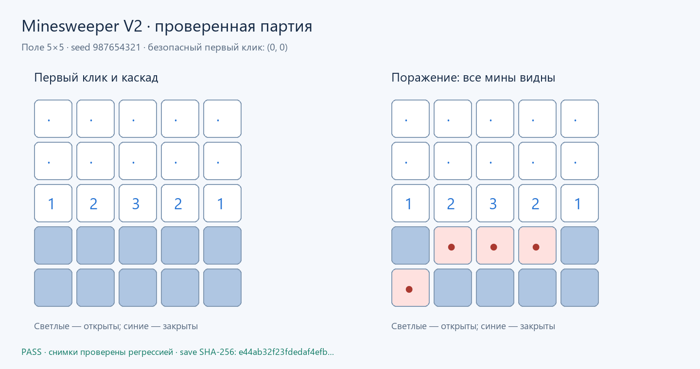

# Minesweeper

Поле 5×5 собрано из 25 экземпляров `mine_cell`, одного `game_controller`
и 25 готовых семисегментных дисплеев. Ячейка хранит мину и состояние
открытия, распространяет открытие пустых соседей и считает соседние мины.
`seven_segment` переводит число 0–8 в семь сигналов дисплея.
Все соединения соседей, управления и дисплеев объявлены в `project.toml`.

Каждая специализация HDL-модуля компилируется один раз. Сборщик копирует
готовую ячейку 25 раз, сохраняет её внутренние стрелки и разводит внешние связи.
`library:seven_segment` подключает дисплей из пакета ArrowsHDL с семью
входами на внешней границе. Сборка не требует существующих файлов в `build/`.

## Сборка

```powershell
arrowshdl build examples/minesweeper/project.toml --compact -o examples/minesweeper/build/minesweeper.save.txt
arrowshdl preview examples/minesweeper/project.toml -o examples/minesweeper/visuals/map.png
```

Каждая команда записывает один файл. Сборка сразу сохраняет схему в формате
импорта игры; метаданные остаются в памяти. Процент и этапы выполнения выводятся
в stderr.

## Управление

Удержать `new_game` до распространения сброса и записи случайных мин,
затем отпустить и дождаться установления. `selected[24:0]` выбирает клетки
в порядке строк, начиная с верхнего левого угла. Первая выбранная клетка
и её соседи защищены от мин. Пустые клетки открывают соседей автоматически.
Индикаторы `opened`, `mine`, `started`, `victory` и `defeat` отражают состояние.
Задержки между границами памяти указаны в метаданных; изменение состояния
может требовать нескольких последовательных интервалов распространения.


## Текстовые дисплеи

Выход `game.victory` подключён к дисплею **WIN**, `game.defeat` — к **LOSE**.
Они описаны в TOML как компоненты `kind="text"` с входом `signal`.
При активном сигнале загораются все стрелки надписи, при сбросе — гаснут.
Буквы используют исходные растры Arrow 4: красные стрелки образуют символы,
синие стрелки соединяют их с управляющим сигналом. `size` задаёт целый масштаб.
Шрифт `library:arrow4` входит в пакет ArrowsHDL.


Регрессионная проверка охватывает два seed,
безопасный первый клик, каскад, числа, победу, поражение, поздние клики и сброс.
Проверяются все стрелки обеих надписей.

```powershell
python -m unittest tests.projects.examples.test_minesweeper -v
```


