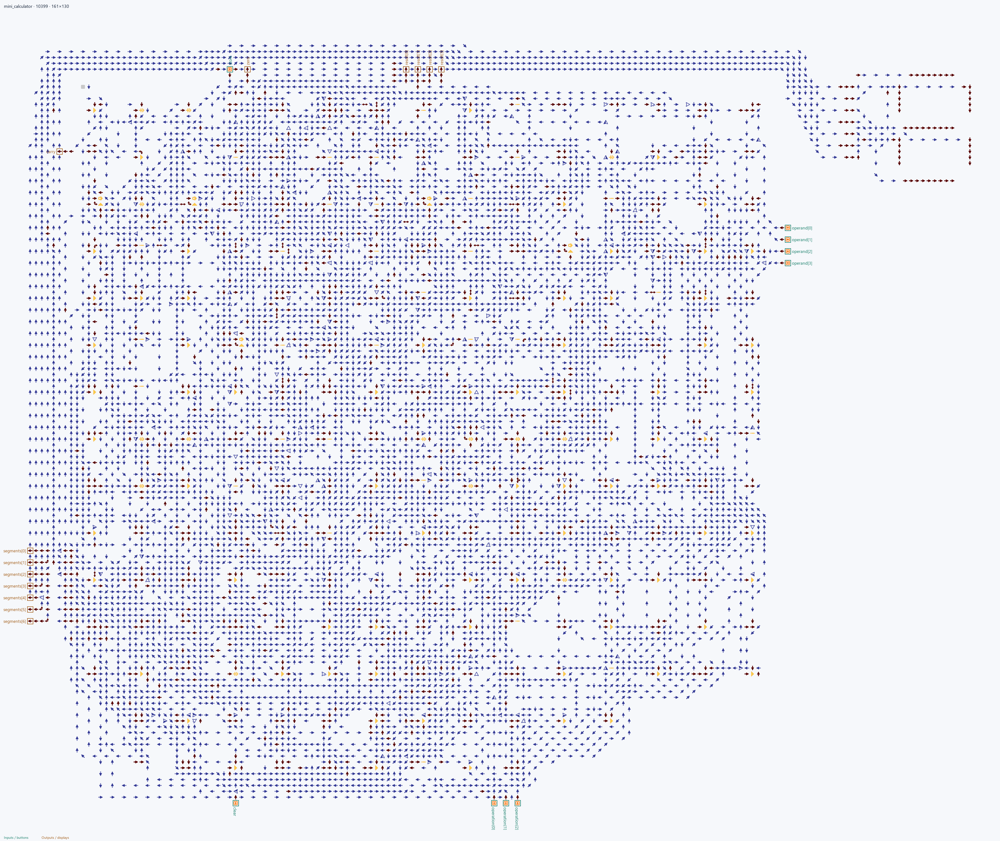

# Mini Calculator

Четырёхразрядный калькулятор с сохраняемым результатом. Он показывает, как
сочетать арифметику и логические операции, внутреннюю память, физические кнопки,
индикаторы и семисегментный дисплей.

## Как пользоваться

- `operand` задаёт число от 0 до 15.
- `operation` выбирает операцию.
- `store` выполняет операцию и сохраняет результат.
- `clear` записывает ноль в регистр результата.
- Дисплей показывает результат в шестнадцатеричном виде.

Операции используют сохранённый результат как левый операнд:

| Код | Операция |
| ---: | --- |
| 0 | Сложение с `operand` |
| 1 | Вычитание `operand` |
| 2 | Побитовое AND |
| 3 | Побитовое OR |
| 4 | Побитовое XOR |
| 5 | Побитовое NOT результата |
| 6 | Сдвиг результата влево на один бит |
| 7 | Загрузить `operand` |

Например, чтобы получить 5: загрузите 3 операцией 7, затем задайте 2 и выберите
операцию 0. Нажатие `store` сохранит сумму `3 + 2`.

## Сборка

Из корня репозитория выполните:

~~~powershell
arrowshdl build examples/mini_calculator/project.toml --preview examples/mini_calculator/build/mini_calculator.png -o examples/mini_calculator/build/mini_calculator.save.txt
~~~

`project.toml` выбирает HDL-файлы и главный модуль. `design.toml` подключает
кнопки, индикаторы и встроенный семисегментный компонент.
