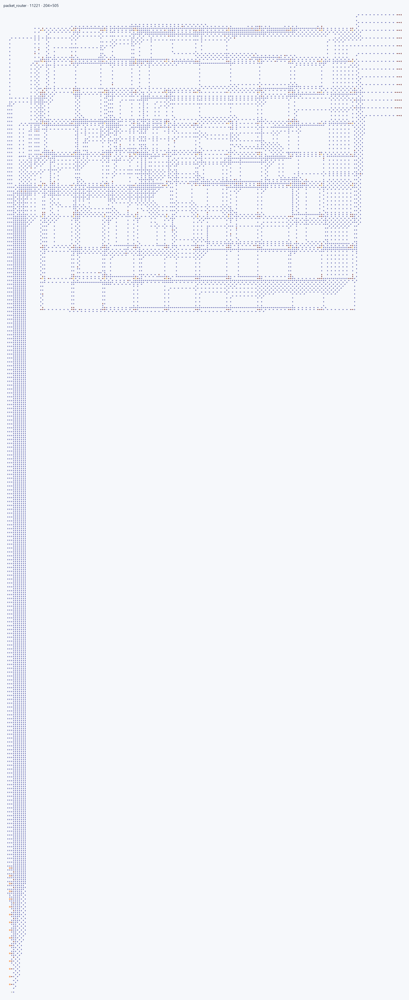
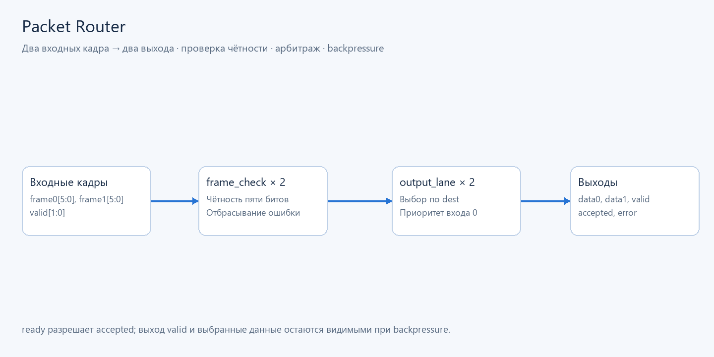
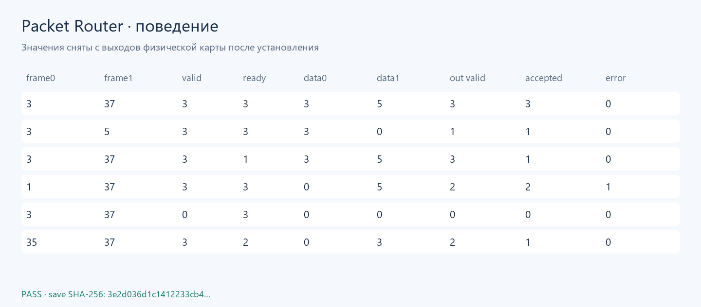

# Packet Router

**Маршрутизатор двух входов на два выхода:** проверка чётности, арбитраж
конкурирующих кадров и подтверждение передачи с учётом готовности приёмника.
Проект показывает композицию повторяемых HDL-модулей и проверку протокола.

Кадр `frame[5:0]`: бит 5 — номер выхода, бит 4 — чётность,
биты 3…0 — данные. XOR пяти младших битов должен быть равен 0.
`valid[i]` сообщает наличие кадра; `error[i]` отмечает неверную чётность
только у присутствующего кадра.

Для каждого выхода `output_lane` выбирает подходящий корректный кадр.
**Вход 0 имеет приоритет** при совпадении назначения.
`output_valid[lane]` и данные видны даже при `ready[lane]=0`;
`accepted[i]` появляется лишь у победителя, когда выход готов.
Очереди и памяти в этом проекте нет: отправитель удерживает кадр до принятия.

## Сборка и проверка

Из корня ArrowsHDL:

~~~powershell
arrowshdl build examples/packet_router/project.toml -o examples/packet_router/build/packet_router.json
arrowshdl test examples/packet_router/build/packet_router.json tests/fixtures/examples/packet_router/vectors.json --vectors -o build/router-demo.report.json
python -m unittest tests.projects.examples.test_showcases.ShowcaseTests.test_router_all_65536_frames_controls_and_backpressure -v
~~~

[Схема](build/packet_router.json): **3487 стрелок, 124×106**.
Кнопки задают биты входов; индикаторы показывают данные, valid, accepted и error.
Порядок битов, контакты и `settle_ticks`: [описание схемы](build/packet_router.json).
Регрессионная проверка охватывает **65 536** наборов:
все кадры, valid и ready. Модель ожиданий независимо описана в tests.

Строки демонстрируют параллельную передачу, конфликт назначения, блокировку
одного выхода, повреждённый кадр, отсутствие valid и приоритет входа 0.
Битовые маски приведены десятичными числами: например, 3 означает два активных бита.

[Физическая карта](visuals/map.png).
Воспроизведение изображений: `python tools/render_examples.py`.
