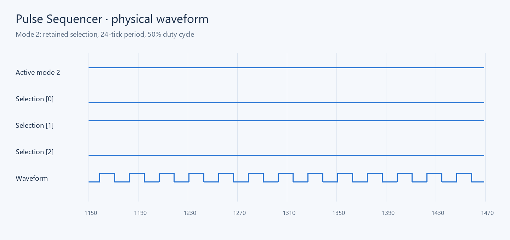

# Pulse Sequencer

Восемь кнопок переключают независимые биты памяти. `selection_memory`
фиксирует фронт нажатия и выбирает младший активный режим; `oscillator_bank`
содержит семь автономных генераторов; `waveform_selector` выбирает сигнал.
TOML связывает модули и готовый дисплей `library:history64` из 64 стрелок.
Библиотека I/O входит в пакет; предварительное содержимое `build/` не требуется.

Режим 0 отключает выход. Периоды режимов 1–7: 20, 24, 32, 40, 48, 64 и 80
игровых тактов. Удержание кнопки даёт одно переключение; повторное нажатие
выключает соответствующий бит. Индикаторы `active` и `selection` показывают
состояние памяти и выбранный режим. История продвигается на одну клетку за такт.

## Сборка и проверка

```powershell
arrowshdl build examples/pulse_sequencer/project.toml -o examples/pulse_sequencer/build/pulse_sequencer.json
arrowshdl preview examples/pulse_sequencer/build/pulse_sequencer.json -o examples/pulse_sequencer/visuals/map.png
python -m unittest tests.projects.examples.test_sequencer -v
```

[Готовая схема](build/pulse_sequencer.json) содержит карту, порты и задержки.
Регрессионная проверка охватывает все 256 масок памяти,
приоритет, удержание кнопок, периоды и каждую клетку истории.



Воспроизведение изображений: `python tools/render_examples.py`.
