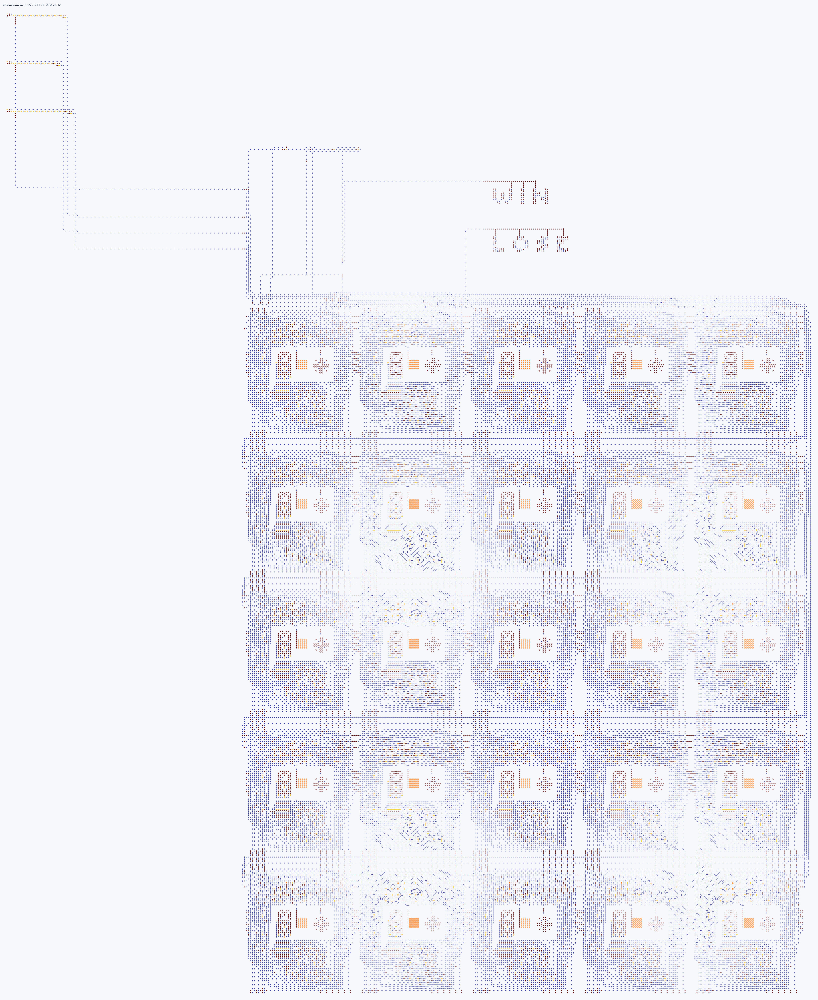
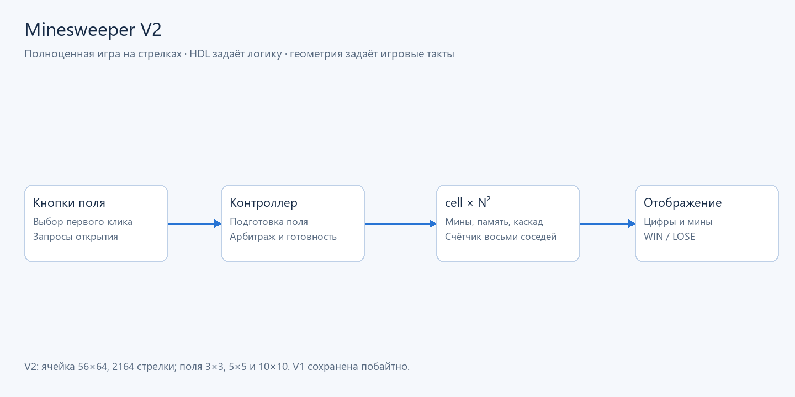

# Minesweeper — исторические схемы

Игра «Сапёр» на стрелках: безопасный первый клик, случайное
размещение мин, подсчёт соседей, каскад нулей, память открытых клеток,
победа и поражение.

Verilog описывает вычисления и связи; физические TOML/JSON задают геометрию
и игровые задержки. V2 состоит из повторяемого модуля `cell`, контроллера,
полевых связей и панели статуса. Это пример крупных нативных проектов,
двумерного generate и проверки протокола на сохранённых клетках.

## Импортировать и играть

Из корня ArrowsHDL после установки пакета:

~~~powershell
arrowshdl preview tests/fixtures/historical/minesweeper/v2/build/minesweeper_5x5.save.txt -o build/mines/board.png
~~~

Для запуска игры код из `minesweeper_5x5.save.txt` импортируется в Logic Arrows.
Кнопка клетки отправляет запрос открытия при запущенной симуляции.
Первый клик защищает выбранную клетку и её соседей; пустые области открываются
каскадом. Цифра показывает количество мин среди восьми соседей.
Открытие всех безопасных клеток даёт **WIN**. Клик по мине даёт **LOSE**,
раскрывает все мины и блокирует дальнейшие открытия. Новая партия начинается
после сброса симуляции. Установка флажков не реализована.

Это визуализация измеренного состояния карты, а не снимок интерфейса игры.
[Реальная карта ячейки V2](visuals/map.png).

## Финальные карты

| Версия | Карта | Стрелок | Размер |
|---|---|---:|---:|
| V1 | [Ячейка](v1/build/tile.save.txt) | 7196 | 112×112 |
| V1 | [3×3](v1/build/minesweeper_3x3.save.txt) | 83273 | 746×659 |
| V1 | [10×10](v1/build/minesweeper_10x10.save.txt) | 892608 | 1530×2964 |
| V2 | [Ячейка](v2/build/tile.save.txt) | 2164 | 56×64 |
| V2 | [3×3](v2/build/minesweeper_3x3.save.txt) | 22638 | 292×352 |
| V2 | [5×5](v2/build/minesweeper_5x5.save.txt) | 60068 | 404×492 |
| V2 | [10×10](v2/build/minesweeper_10x10.save.txt) | 233969 | 684×842 |

Исторические исходники и проверки: [V1](v1/README.md), [V2](v2/README.md).
Их TOML относятся к старому формату; текущая компиляция v3 показана в
[основном примере](../../../../examples/minesweeper/README.md).
**V1 сохранена побайтно**: [эталонные хеши](v1/preservation.json).
Её исторические ограничения: нет общей панели статуса и раскрытия всех мин;
показывается только открытая мина. Центральный первый клик на 3×3 защищает
всё поле, поэтому мин там нет. V2 реализует общие статусы и раскрытие мин.

## Тестирование

~~~powershell
python -m unittest tests.projects.minesweeper.test_saved_maps -v
~~~

Команда проверяет сохранённые исторические карты в памяти; сценарии,
стрелки тестовых контактов и результаты не сохраняются отдельными JSON-файлами.
Проверки выполняют 256 масок соседей, 512 переходов, счётчики, все квадраты кнопок,
два seed, безопасный первый клик, каскад, победу, поражение и блокировку.
V2 дополнительно проверяет одновременные первые клики, поздние клики во время
подготовки, все пиксели статуса и раскрытие мин. При одновременном выборе
побеждает первый запрос по порядку контроллера.

Воспроизведение визуализаций текущих примеров: `python tools/render_examples.py`.
Собственный код: PolyForm Noncommercial 1.0.0, Copyright 2026 Nnican.
Авторство правил и ресурсов Logic Arrows сохраняется.
