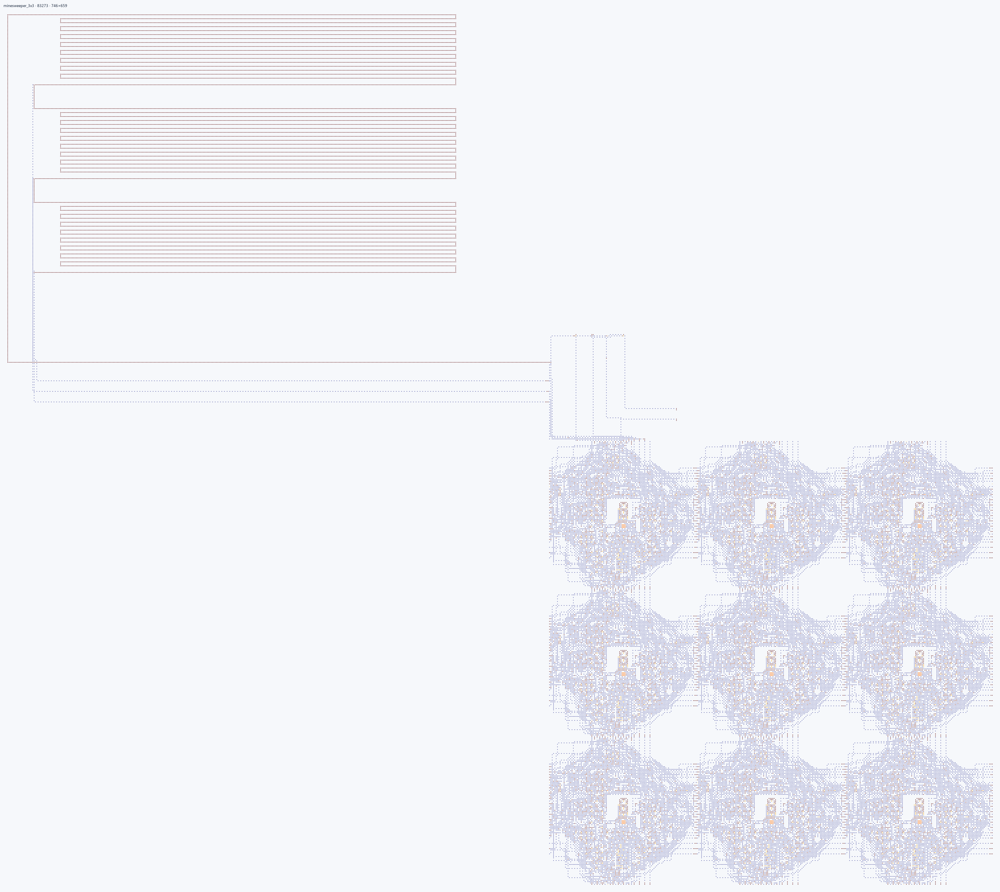

# Сапёр V1

Версия исходной ячейки **112×112**.
Логика описана в `cell.v`, `cell_top.v`, исходниках полей и контроллера;
геометрия — в JSON и физическом TOML старого формата. Готовые карты сохранены
как исторические регрессионные фикстуры.

Из корня ArrowsHDL с установленным ArrowsHDL:

```powershell
python -m unittest tests.projects.minesweeper.test_saved_maps.MinesweeperRegressionTests.test_v1_historical_112_maps -v
```

Сохранения V1 побайтно воспроизводят исходный комплект previous-112:
[проверка сохранности](preservation.json). Их точные SHA-256 также закреплены
в регрессионной фикстуре ArrowsHDL.
Полный проверяемый запуск и ограничения: [описание проекта](../README.md).
Проверки создают сценарии и отчёты в памяти; папка сборки содержит только
итоговые сохранения схем.
