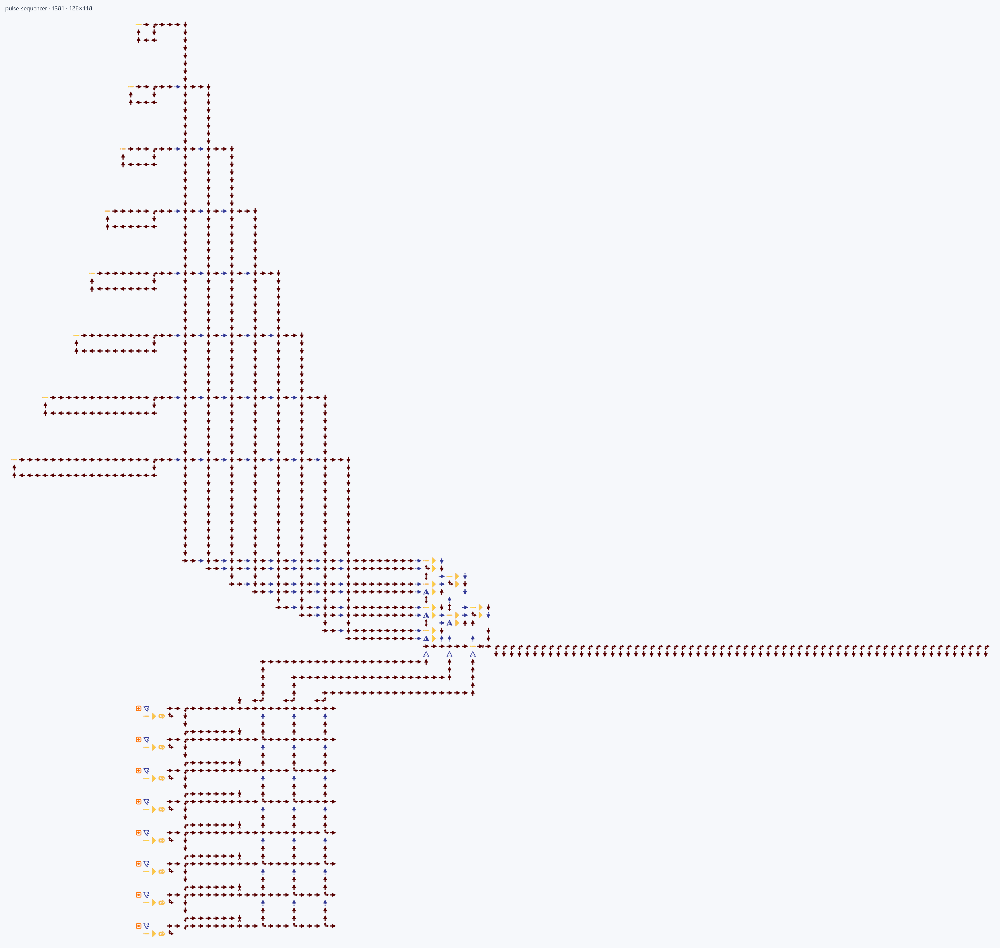
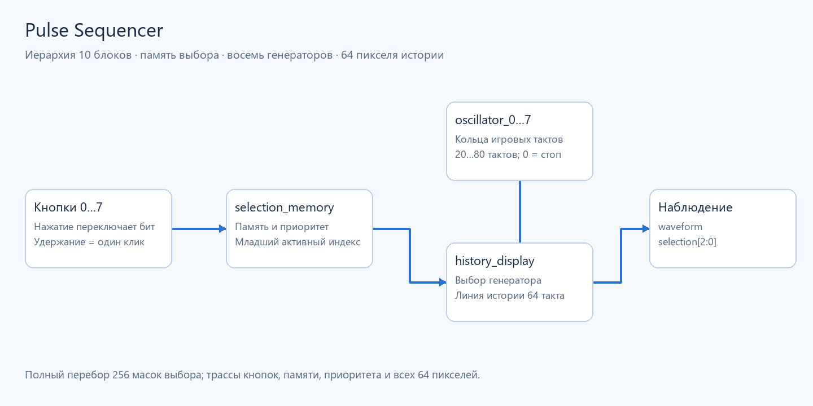
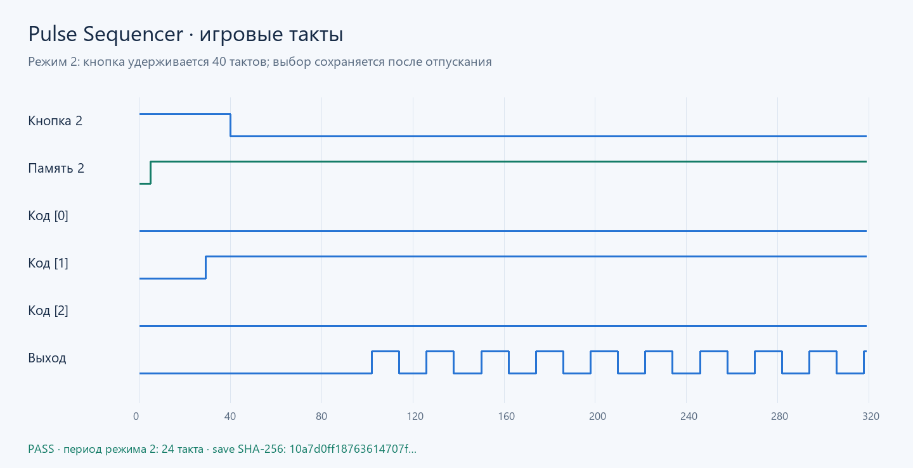

# Pulse Sequencer

**Генератор импульсов с памятью выбора и историей сигнала.**
Десять физических HDL-блоков: восемь `oscillator_*`, `selection_memory`
и `history_display`. Верхний модуль связывает их через именованные сигналы.
Геометрия хранится отдельно и сохраняет задержки реальных игровых тактов.

Кнопки 0…7 переключают независимые биты памяти. Удержание кнопки считается
одним нажатием; повторное нажатие снимает выбор. При нескольких активных
битах побеждает **младший индекс**. Режим 0 отключает выход.

| Выбранный режим | Период, игровые такты |
|---:|---:|
| 0 | Выход отключён |
| 1 | 20 |
| 2 | 24 |
| 3 | 32 |
| 4 | 40 |
| 5 | 48 |
| 6 | 64 |
| 7 | 80 |

`waveform` показывает выбранный сигнал; `selection[2:0]` — индекс.
Дисплей из 64 пикселей хранит последние 64 такта, по одному такту на пиксель.

## Сборка и воспроизведение трассы

Из корня ArrowsHDL:

~~~powershell
arrowshdl build examples/pulse_sequencer/project.toml -o examples/pulse_sequencer/build
arrowshdl simulate examples/pulse_sequencer/build/pulse_sequencer.save.txt examples/pulse_sequencer/scenario.json -o build/sequencer.trace.json
python -m unittest tests.projects.examples.test_native_examples.NativeExampleTests.test_loop_mux8_held_simultaneous_masks_and_history -v
~~~

[Сохранение](build/pulse_sequencer.save.txt): **1381 стрелка, 126×118**.
Кнопки находятся в `(-32, 24+4i)`, i=0…7; первый пиксель истории — `(14,18)`.
Формальные порты описаны в исходных привязках; проверка памяти создаёт тестовые
контакты в памяти и не оставляет рядом со схемой JSON-отчётов.

`scenario.json` нажимает кнопку 2 на 40 тактов и проверяет ещё 2008 тактов
после отпускания. Ожидания получены независимой моделью правил клеток.
Это входной сценарий для CLI; автотесты создают сценарии в коде и не сохраняют
их или результаты на диск.

[Физическая карта](visuals/map.png) ·
[Измеренная трасса](visuals/behavior.png).
Визуализации воспроизводятся через `python tools/render_examples.py`.
